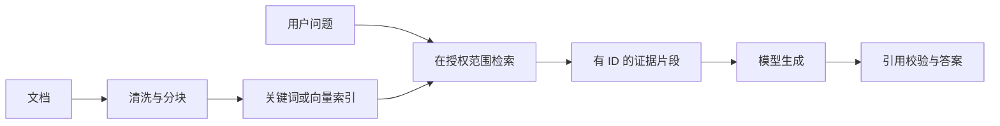

# 第2天：RAG 与知识检索

目标：理解今天的机制，并能在小型知识库 Agent 中指出它的落点。

## 1. RAG 分成两条链路

离线链路：原文 → 解析清洗 → 分块 → 元数据与索引。在线链路：问题 → 检索 → 组织证据 → 模型生成 → 引用校验。RAG 的检索可以是关键词、向量或二者融合，不是必须先装向量数据库。

本项目首版仅有 5–20 篇自建 Markdown 文档，使用关键词检索即可验证工具闭环。向量检索是升级实验，用来体验语义匹配，而不是为了补齐技术名词。

## 2. 分块和元数据

优先按标题和段落切分，保留标题路径、docId、chunkId、版本、所属知识库和内容哈希。短文保留完整段落；长段落可先以约 300–600 个中文字符试切，重叠 50–100 字，再结合实际 token 上限和评测调整。这些是实验起点，不是最佳参数。

表格、代码与配置尽量作为完整单元，不能把错误码与解释拆开。内容不变时复用索引；新版本完成构建后一次性替换当前索引，避免一半旧文档、一半新文档。

## 3. Embedding 和向量距离

Embedding 将文本映射成数值向量，相近语义通常距离更近，但相似不代表事实相同。文档与问题必须使用同一模型、同一维度及相容预处理。更换 embedding 模型一般要重建文档向量，不能直接混用。

可以用余弦距离排序。小数据先做精确检索，数据变大再评估 HNSW 等近似索引；近似检索以部分召回损失换延迟。pgvector 能复用 PostgreSQL 的数据管理；Qdrant 是独立向量服务；Milvus 先了解用途即可。

## 4. 检索、重排与生成

召回关注“把可能有用的片段找出来”；重排关注“把候选里最相关的排前面”。先取 3 个片段建立基线，记录召回问题后再扩候选、加混合检索或重排。不要一开始为每个请求追加重排 API。

所有返回片段应来自用户可访问的知识范围。无权限数据不能先传给模型再让模型保密。

## 5. RAG 与微调

检索便于更新和追溯动态知识；微调常用于行为、格式或特定任务适配。两者可组合。RAG 的失败可能在分块、召回、版本、证据理解或生成，应分层定位。

阅读：[官方资源](../官方学习资源.md)。完成后进入 [实操任务](02-实操任务与验收.md) 和 [面试要点](03-面试要点.md)。
