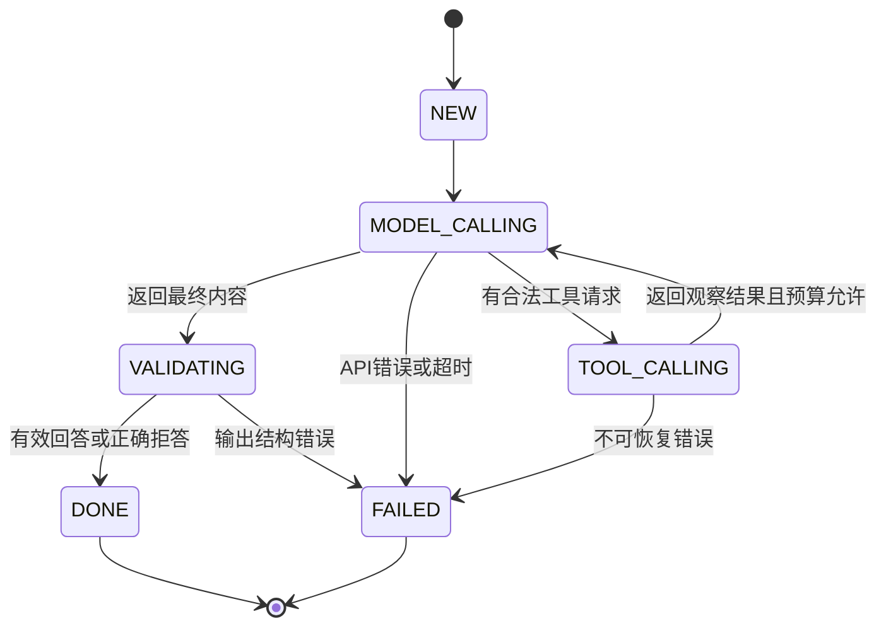

# 第4天：Memory、会话与任务状态

目标：理解今天的机制，并能在小型知识库 Agent 中指出它的落点。

## 1. 三种状态分别管理

| 类型 | 保存什么 | 本项目做法 |
|---|---|---|
| 会话历史 | 用户与助手的完整回合 | 内存保留最近 4 个成功回合，TTL 30 分钟 |
| 当前任务状态 | 本次工具调用、计数、deadline、证据 ID | 请求级对象，失败也形成终态 |
| 长期记忆 | 经确认的偏好或历史事实 | 首版不做，避免把错误回答永久保存 |

把历史文本存进向量库不代表自动获得可靠记忆。历史也可能过期、包含敏感信息或带来提示注入。

## 2. 多轮上下文

用户追问“那怎么恢复？”时，需要前文知道“那”指哪个服务。先传最近完整回合即可，超预算按完整回合淘汰，保留系统指令和当前问题。本次工具调用与 tool 结果必须成组保留，不能裁掉一半协议消息。

历史中的引用只能视为旧记录；新一轮需要重新检索当前索引，不能把用户无权再访问的旧证据直接发给模型。

## 3. 隔离与并发

会话通过 `(principalId, sessionId)` 定位。首版只监听 localhost，使用固定本地演示身份；增加多人功能时必须认证，并检查会话归属，不能靠客户端提交 userId。随机 UUID 不能代替授权。

同会话只允许一个请求执行，冲突返回 409；不同会话在全局并发配额内独立执行。会话达到数量上限后淘汰过期项，不无限占用内存。服务重启丢失历史是首版明确限制。

## 4. 任务状态机

`NEED_CONFIRMATION` 用于写操作等需要人工批准的任务，本项目只有只读工具，因此不强行加入该状态；面试应说明何时才需要它。

## 5. 将来如何持久化

需要跨重启演示时可增加 SQLite/PostgreSQL，分别存 sessions、messages、runs、tool_calls。恢复任务不能简单重放全部步骤：只读检索可重做，写工具必须考虑幂等键和人工确认。

阅读：[官方资源](../官方学习资源.md)。完成后进入 [实操任务](02-实操任务与验收.md) 和 [面试要点](03-面试要点.md)。
